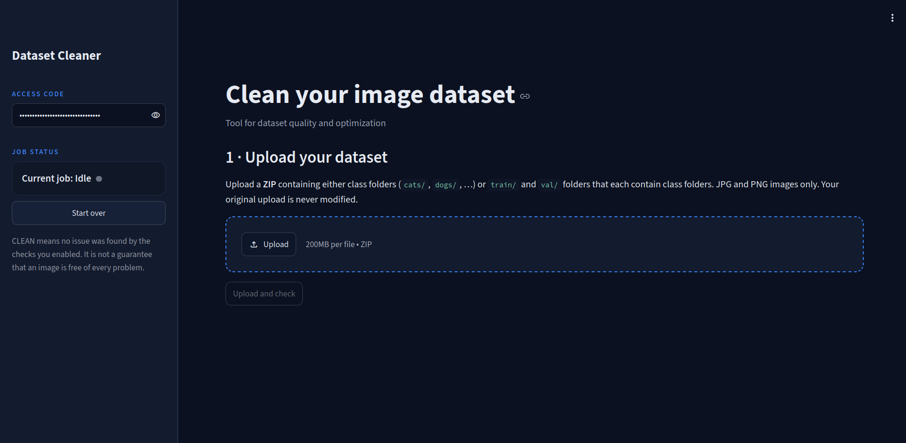

# Image Dataset Cleaning Framework

Upload an image dataset (ZIP) and get back a cleaned copy. The tool finds duplicates, blurry and noisy images, outliers and likely mislabels, shows you why each image was flagged, and lets you approve what gets removed. Your original upload is never modified.




## Features

| Check | Method |
|---|---|
| Exact / near duplicates | pHash + BK-tree, verified with ResNet50 cosine similarity |
| Blur | Laplacian variance, adaptive per-class threshold |
| Noise | Convolutional autoencoder reconstruction error |
| Outliers | PCA + Isolation Forest (global and per class) |
| Mislabels | DBSCAN + nearest neighbours + class centroids (3-vote ensemble) |

A decision engine combines the signals into **CLEAN**, **REVIEW** or **REMOVE**. Proposed removals are never applied unless you approve them.

## Run it

### Option 1: Docker (recommended)

Requires Docker and about 4 GB of free disk.

```bash
git clone https://github.com/24je0657/image-cleaning-framework.git
cd image-cleaning-framework

docker build -t cleaner .

# Create an access code (16+ characters) and keep it private
export CODE="$(python -c 'import secrets;print(secrets.token_urlsafe(24))')"
echo "$CODE"

docker run --rm -p 7860:7860 -e IMAGE_CLEANING_ACCESS_CODES="$CODE" cleaner
```

Open <http://localhost:7860>, paste the code in the sidebar, and upload a ZIP.

### Option 2: Local Python

```bash
python -m venv venv && source venv/bin/activate
pip install -r requirements.txt

python run_api.py                                          # terminal 1
streamlit run cleaner_app.py --server.maxUploadSize 500    # terminal 2
```

Without `IMAGE_CLEANING_ACCESS_CODES` set, access control is off. Use this only on your own machine.

### Option 3: Command line

```bash
python run_pipeline.py --data_dir data/raw/Animal --output_dir data_clean/Animal
```

Reports are written to `reports/<dataset_name>/`.

## Using the web app

1. **Upload** a ZIP of class folders (`cats/`, `dogs/`) or `train/` and `val/` folders. JPG and PNG only, at least 30 images per class in each split.
2. **Choose checks** and start cleaning (about 1 minute for 500 images on a laptop CPU).
3. **Review** flagged images with the reason for each one.
4. **Approve** and build the cleaned dataset.
5. **Download** a ZIP with the images, `approval_decisions.csv` and `summary.json`.

## Results

Run on two datasets with no code changes. These are the tool's decisions, not detector accuracy.

| | Animal (5 classes) | Intel (6 classes) |
|---|---:|---:|
| Images | 14,971 | 17,034 |
| Clean | 11,847 (79.1%) | 12,946 (76.0%) |
| Review | 2,431 | 3,651 |
| Remove | 693 | 437 |

Manual checks on Animal: duplicate detection 50/50 correct, high-confidence mislabels 37/37 correct.

**Effect on a classifier** (logistic regression on frozen ResNet50 features, same validation set):

| Training set | Images | Accuracy |
|---|---:|---:|
| Random subset (mean of 5 draws) | 10,626 | 99.01% |
| Cleaned, CLEAN only | 10,626 | 97.93% |
| Default workflow (REMOVE verdicts only) | 12,847 | 99.00% (random: 99.05%) |

Cleaning did not beat a random subset of the same size. The default workflow is indistinguishable from random (−0.05 points, under one validation image), and keeping only CLEAN images costs about 1 point. Outlier removal is the largest single cost. The validation set comes from the same distribution, so this says nothing about new data.

## Limitations

- Laplacian blur measures edge density, so some smooth but sharp images are flagged.
- CLEAN means no issue was found by the checks you enabled, not that the image is perfect.
- Demo-grade access control: shared codes, not user accounts. Deploy only behind HTTPS.
- Uploaded data is deleted after 24 hours and downloads after 6. Jobs do not survive a restart.

## Project layout

```
src/          detection modules and decision engine
api/          FastAPI backend (upload, jobs, results, download)
cleaner_app.py   Streamlit upload wizard
app.py           original analysis dashboard
run_pipeline.py  command-line pipeline
tests/        automated tests
```

Run the tests with `python -m pytest -q`.

## Tech

Python, PyTorch (ResNet50, autoencoder), scikit-learn, OpenCV, FastAPI, Streamlit, Docker.